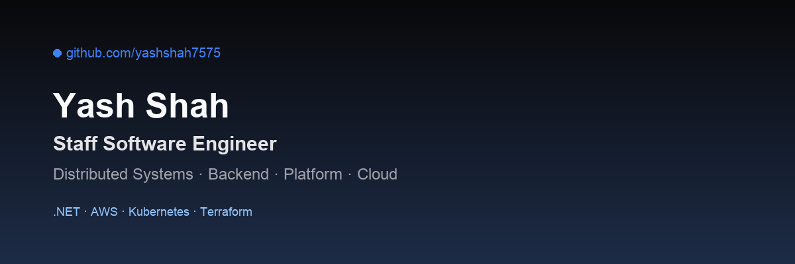

# Yash Shah

**Software Engineer | Applied AI · Financial Technology · Cloud-Native Systems**

I build intelligent applications, distributed software systems, and financial technology platforms.

My background includes over 11 years of software engineering experience across enterprise systems, cloud architecture, and investment technology. I hold master's degrees in Finance and Information Technology.

My work increasingly focuses on applied AI, particularly autonomous engineering agents, enterprise knowledge retrieval, and reliable software automation.

I also explore financial markets, quantitative research, and the engineering behind investment platforms.

## Areas of Focus

### Applied Artificial Intelligence

- AI engineering agents and LLM-powered applications
- Agent orchestration and Model Context Protocol (MCP)
- Enterprise knowledge retrieval and RAG
- Controlled tool execution and automated engineering workflows
- Evaluation, reliability, and human oversight

### Financial Technology

- Investment platforms and financial market data
- Quantitative research and algorithmic trading
- Portfolio analytics and risk management
- Financial decision-support systems
- Rule-based investment strategies

### Cloud-Native Systems

- C#, .NET, and ASP.NET Core
- AWS and Kubernetes
- Distributed systems and event-driven architectures
- REST APIs, microservices, and messaging
- Terraform, CI/CD, and observability

## Featured Open-Source Projects

### .NET Engineering Agent

[View Repository](https://github.com/yashshah7575/.Net-Developer-Agent)

A repository-aware AI engineering agent using C#, Amazon Bedrock, and Microsoft.Extensions.AI.

Explores planning, source-code modification, controlled tool execution, build/test automation, and validation of implementation results.

### Secure Multi-Tenant API

[View Repository](https://github.com/yashshah7575/customer-api)

An ASP.NET Core reference implementation exploring OAuth 2.0, OpenID Connect, Keycloak integration, authorization policies, and multi-tenant data isolation.

### Local LLM Inference with .NET

[View Repository](https://github.com/yashshah7575/dotnet-local-llm-chat-llamasharp)

A C# application exploring offline language-model inference using LLamaSharp and GGUF models.

### Quantitative Finance Experiments

[View Repository](https://github.com/yashshah7575/quant-tsla-beta-moving-average-strategy)

Educational quantitative finance experiments involving beta estimation, moving-average signals, and strategy backtesting.

### AWS Serverless Infrastructure

[View Repository](https://github.com/yashshah7575/dotnet-aws-lambda-terraform-starter)

A reference implementation for deploying ASP.NET Core APIs with AWS Lambda, API Gateway, and Terraform.

## Research Interests

My research interests connect practical software engineering with artificial intelligence and financial technology.

**Reliable Enterprise AI Systems**  
Agent evaluation, organizational context retrieval, secure tool execution, and multi-step workflow reliability.

**AI and Financial Markets**  
Market efficiency, financial machine learning, quantitative strategies, transaction costs, and risk-adjusted performance.

**Cloud Infrastructure for Intelligent Applications**  
Model deployment, local versus cloud inference, cost optimization, system reliability, and observability.

Research papers and experimental results will be shared on my personal website as they become available.

## Engineering Philosophy

I prefer systems that solve real problems, remain understandable, and can be operated reliably.

- Start with the problem, not the technology.
- Keep architectural decisions and tradeoffs explicit.
- Design for reliability, security, and maintainability.
- Measure outcomes rather than complexity.
- Use AI to augment engineering judgment while retaining human accountability.

## Connect

- **Website:** [yashshah.ai](https://yashshah.ai)
- **LinkedIn:** [linkedin.com/in/yashshah7575](https://www.linkedin.com/in/yashshah7575)
- **GitHub:** [github.com/yashshah7575](https://github.com/yashshah7575)

Based in Chicago, Illinois, United States.
